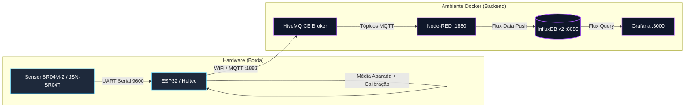

# 🌊 Sistema IoT para Monitoramento de Nível e Volume em Reservatórios

[](https://www.espressif.com/)
[](https://www.docker.com/)
[](https://www.hivemq.com/)
[](https://nodered.org/)
[](https://www.influxdata.com/)
[](https://grafana.com/)
[](#)

Este projeto implementa uma pipeline completa de telemetria e processamento de dados IoT em tempo real para medição precisa de **distância (nível de água)** e **cálculo volumétrico** em reservatórios.

A solução integra aquisição de dados via sensor ultrassônico subaquático/à prova d'água com microcontrolador **ESP32**, filtragem digital de ruídos (algoritmo de **Média Aparada**), tolerância a falhas via **MQTT (LWT)**, processamento e ingestão de fluxo com **Node-RED**, persistência em banco temporal **InfluxDB v2** e visualização analítica em painéis dinâmicos no **Grafana**, tudo orquestrado através do **Docker Compose**.


---

## 📑 Sumário

- [Arquitetura do Sistema](#-arquitetura-do-sistema)
- [Tecnologias Utilizadas](#-tecnologias-utilizadas)
- [Engenharia de Hardware e Firmware](#-engenharia-de-hardware-e-firmware)
  - [Esquema de Pinagem](#esquema-de-pinagem-esp32--jsn-sr04t--sr04m-2)
  - [Algoritmo de Filtragem (Média Aparada)](#algoritmo-de-filtragem-e-tratamento-de-sinais)
  - [Curva de Calibração Volumétrica](#curva-de-calibração-volumétrica)
  - [Mapeamento de Tópicos MQTT](#mapeamento-de-tópicos-mqtt-e-payloads)
- [Estrutura de Diretórios](#-estrutura-de-diretórios)
- [Portas e Serviços da Infraestrutura](#-portas-e-serviços-da-infraestrutura)
- [Como Executar o Projeto](#-como-executar-o-projeto-passo-a-passo)
  - [Pré-requisitos](#pré-requisitos)
  - [1. Clonar o Repositório](#1-clonar-o-repositório)
  - [2. Configuração Inicial do Ambiente (.env)](#2-configuração-inicial-do-ambiente-env)
  - [3. Setup Inicial do InfluxDB e Obtenção do Token](#3-setup-inicial-do-influxdb-e-obtenção-do-token)
  - [4. Iniciar o Ambiente Completo com Docker Compose](#4-iniciar-o-ambiente-completo-com-docker-compose)
  - [5. Configurar e Importar o Fluxo no Node-RED](#5-configurar-e-importar-o-fluxo-no-node-red)
  - [6. Acessar o Dashboard no Grafana](#6-acessar-o-dashboard-no-grafana)
  - [7. Configurar e Gravar o Firmware do ESP32](#7-configurar-e-gravar-o-firmware-do-esp32)
- [Gerenciamento do Ambiente Docker](#-gerenciamento-do-ambiente-docker)
- [Autoria e Agradecimentos](#-autoria-e-agradecimentos)

---

## 🏛️ Arquitetura do Sistema

O fluxo de dados segue um padrão moderno, distribuído e desacoplado orientado a mensagens:



### Papel de Cada Componente

| Camada | Tecnologia | Função Principal |
| :--- | :--- | :--- |
| **Aquisição / Borda** | ESP32 + Sensor SR04M-2 | Leitura UART serial, validação de Checksum, filtragem digital por média aparada e publicação MQTT periódica com LWT. |
| **Mensageria** | HiveMQ CE | Broker MQTT de alto desempenho para distribuição assíncrona das mensagens entre dispositivos e serviços. |
| **ETL / Ingestão** | Node-RED | Subscrição nos tópicos MQTT, validação e formatação do payload para o modelo de medições e tags do InfluxDB v2. |
| **Armazenamento Temporal** | InfluxDB v2.7 | Time-series database otimizada para consultas históricas e agregação temporal (`aggregateWindow`). |
| **Visualização Analítica** | Grafana 10.4 | Painéis em tempo real com séries temporais de nível (cm) e volume (mL), limites críticos e indicadores visuais. |

---

## 🛠️ Tecnologias Utilizadas

* **Hardware & Firmware:**
  * Microcontrolador: **ESP32** (Heltec WiFi LoRa 32 / ESP32 Dev Module).
  * Sensor de Nível: **Sensor Ultrassônico à Prova D'Água (JSN-SR04T / AJ-SR04M / SR04M-2)**.
  * Linguagem & Frameworks: C++ (Arduino Core), bibliotecas `PubSubClient`, `WiFi` e `HardwareSerial`.
* **Backend & Infraestrutura:**
  * Orquestração: **Docker** & **Docker Compose**.
  * Broker MQTT: **HiveMQ Community Edition**.
  * Pipeline de Dados (ETL): **Node-RED**.
  * Time-Series Database: **InfluxDB 2.7**.
  * Monitoramento / Dashboards: **Grafana 10.4.2** (com provisionamento automatizado de datasources e dashboards).
* **Protocolos de Rede:**
  * **MQTT** (Message Queuing Telemetry Transport) com suporte a *Last Will and Testament (LWT)*.
  * **HTTP / REST / Flux** para integração entre Node-RED, InfluxDB e Grafana.

---

## ⚡ Engenharia de Hardware e Firmware

### Esquema de Pinagem (ESP32 ⇄ JSN-SR04T / SR04M-2)

O sensor opera no modo de saída serial automática (RTT/UART a 9600 baud, 8N1), enviando pacotes contínuos de 4 bytes: `0xFF`, `Data_H`, `Data_L` e `Checksum`.

| Sensor Ultrassônico | Pino ESP32 | Descrição |
| :--- | :--- | :--- |
| **5V / VCC** | `5V / VIN` | Alimentação de 5V DC |
| **GND** | `GND` | Referência comum de terra |
| **TX** | `GPIO 13` (RX1) | Recepção de dados seriais pelo ESP32 |
| **RX** | `GPIO 17` (TX1) | Linha de comando/trigger serial |

> ⚠️ **Filtro de Zona Cega:** O firmware descarta leituras fora da faixa linear de operação confiável do sensor ultrassônico ($< 20.0\text{ cm}$ ou $> 55.0\text{ cm}$).

### Algoritmo de Filtragem e Tratamento de Sinais

A água em reservatórios sofre perturbações superficiais causadas por vazão, entrada de fluxo e reverberação acústica no invólucro. Para eliminar ruídos e *outliers*:

1. **Validação por Checksum:** Apenas quadros cujo quarto byte seja igual à soma ponderada dos 3 primeiros bytes são aceitos:
   $$\text{CS} = \text{Buffer}[0] + \text{Buffer}[1] + \text{Buffer}[2]$$
2. **Buffer Circular:** Armazena uma janela móvel de $N = 15$ leituras válidas.
3. **Média Aparada (Trimmed Mean):** O vetor é ordenado e os **3 menores** e **3 maiores** valores são descartados (20% de corte em cada cauda):
   $$\text{Distância}_{\text{filtrada}} = \frac{1}{9} \sum_{i=3}^{11} \text{AmostrasOrdenadas}[i]$$

### Curva de Calibração Volumétrica

Com base na geometria do reservatório e ensaios de calibração hidrostática, o volume real é derivado diretamente da distância do sensor ao espelho d'água pela equação ajustada:

$$\text{VolumeReal (mL)} = \frac{\text{Distância (cm)} - 47.201}{-0.02074}$$

### Mapeamento de Tópicos MQTT e Payloads

| Tópico | QoS | Retain | Exemplo de Payload | Significado |
| :--- | :---: | :---: | :--- | :--- |
| `sensores/nivel_agua` | 0 | Sim | `{"distancia_cm": 28.4, "volume_ml": 906.5}` | Telemetria enviada a cada 3 segundos. |
| `sensores/nivel_agua/status` | 0 | Sim | `"online"` / `"offline"` / `"sem_leitura"` | Monitor de liveness via LWT e diagnóstico de sensor solto. |

---

## 📁 Estrutura de Diretórios

```text
PROJETO-IOT/
└── iot-reservatorio/
    ├── docker-compose.yml           # Definição e orquestração dos serviços (HiveMQ, Node-RED, InfluxDB, Grafana)
    ├── env.example                  # Modelo de variáveis de ambiente do projeto
    ├── .env                         # Variáveis de ambiente locais (não versionadas)
    ├── flows.json                   # Fluxo exportado do Node-RED pronto para importação
    ├── README.md                    # Documentação técnica do projeto
    ├── firmware_esp/
    │   └── main.cpp                 # Código-fonte em C++ com Média Aparada, LWT e MQTT para ESP32
    └── grafana_config/
        └── provisioning/
            ├── datasources/
            │   └── datasource.yaml  # Provisionamento automático do datasource InfluxDB (v2 Flux)
            └── dashboards/
                ├── dashboards.yaml  # Provedor automático de dashboards do Grafana
                └── Monitorament_de_nivel.json # Painel analítico com telemetria de nível e volume
```

---

## 🌐 Portas e Serviços da Infraestrutura

| Serviço | Porta do Host | Protocolo / Descrição | URL de Acesso Local |
| :--- | :---: | :--- | :--- |
| **HiveMQ CE (MQTT)** | `1883` | Protocolo MQTT padrão (TCP) para conexão do ESP32 | `mqtt://localhost:1883` |
| **HiveMQ CE (WS)** | `8080` | Protocolo MQTT sobre WebSockets (para clientes Web) | `ws://localhost:8080/mqtt` |
| **Node-RED** | `1880` | Interface Visual de Fluxos ETL | [http://localhost:1880](http://localhost:1880) |
| **InfluxDB v2** | `8086` | Painel Web e API de Séries Temporais | [http://localhost:8086](http://localhost:8086) |
| **Grafana** | `3000` | Painéis e Dashboards de Visualização | [http://localhost:3000](http://localhost:3000) |

---

## 🚀 Como Executar o Projeto Passo a Passo

### Pré-requisitos

* [Docker Desktop](https://www.docker.com/products/docker-desktop/) (Windows/Linux/macOS) instalado e em execução.
* [Git](https://git-scm.com/) instalado no terminal.
* [PlatformIO](https://platformio.org/) (recomendado no VS Code) ou [Arduino IDE](https://www.arduino.cc/en/software) com as bibliotecas:
  * `PubSubClient` (por Nick O'Leary)
  * `WiFi` (inclusa no core ESP32)

---

### 1. Clonar o Repositório

```bash
git clone https://github.com/Sergio-now/iot-reservatorio.git
cd iot-reservatorio
```

---

### 2. Configuração Inicial do Ambiente (.env)

Copie o arquivo de exemplo para gerar o seu arquivo `.env`:

```bash
cp env.example .env
```

Abra o arquivo `.env` e preencha as configurações do InfluxDB e Grafana (o campo `INFLUXDB_TOKEN` ficará vazio por enquanto, pois o geraremos no passo a seguir dentro da interface do InfluxDB):

```ini
# --- InfluxDB ---
INFLUXDB_USER=seu_usuario
INFLUXDB_PASSWORD=sua_senha_segura
INFLUXDB_ORG=SCA
INFLUXDB_BUCKET=Reservatorio-IOT
INFLUXDB_TOKEN=

# --- Grafana ---
GRAFANA_USER=admin
GRAFANA_PASSWORD=sua_senha_grafana
```

---

### 3. Setup Inicial do InfluxDB e Obtenção do Token

Para garantir que o Grafana e o Node-RED não iniciem com erros de autenticação por falta de token, iniciaremos primeiro **apenas o serviço do InfluxDB**:

1. Suba exclusivamente o contêiner do InfluxDB:
   ```bash
   docker compose up -d influxdb
   ```

2. Aguarde cerca de 15 a 30 segundos e acesse o painel do InfluxDB no seu navegador: [http://localhost:8086](http://localhost:8086).
   * Faça login com o usuário (`INFLUXDB_USER`) e senha (`INFLUXDB_PASSWORD`) definidos no seu `.env`.

3. Gere o seu Token de API com acesso total:
   * No menu lateral esquerdo, vá em **Load Data** ➔ **API Tokens**.
   * Clique no botão **Generate API Token** ➔ escolha **All Access Token**.
   * Dê uma descrição (ex: `Token_Integracao_IoT`) e clique em **Save**.

4. Clique no token criado, copie o valor gerado, abra o seu arquivo `.env` e cole o token:
   ```ini
   INFLUXDB_TOKEN=seu_token_copiado_aqui
   ```

---

### 4. Iniciar o Ambiente Completo com Docker Compose

Agora que o arquivo `.env` já contém o token válido gerado pelo InfluxDB, inicialize todos os serviços do ecossistema:

```bash
docker compose up -d
```

> 💡 *Dica:* Como o `.env` agora possui o token correto, o Grafana e os demais serviços iniciarão já devidamente autenticados com o InfluxDB via `datasource.yaml`.

Verifique se todos os contêineres estão operando com status `Up`:

```bash
docker compose ps
```

---

### 5. Configurar e Importar o Fluxo no Node-RED

1. Abra o Node-RED no navegador: [http://localhost:1880](http://localhost:1880).
2. **Instalar a paleta do InfluxDB (Obrigatório):**
   * No canto superior direito, clique no menu principal **☰** ➔ **Gerenciar paleta (Manage palette)**.
   * Selecione a aba **Instalar (Install)**.
   * Pesquise por `node-red-contrib-influxdb` e clique no botão **Instalar (Install)**. Aguarde a conclusão da instalação.
3. **Importar o Fluxo:**
   * No menu principal **☰**, vá em **Importar (Import)**.
   * Clique em **selecionar um arquivo para importar** e escolha o arquivo `flows.json` da raiz do projeto.
4. **Inserir o Token no InfluxDB:**
   * Dê um duplo clique no nó final **`[v2.0] InfluxDB: dados`**.
   * Clique no ícone de lápis ✏️ ao lado do campo *Server* (`cfg_influxdb_v2`).
   * A URL (`http://influxdb:8086`) e a Organização (`SCA`) já estão configuradas. Apenas cole o seu **`INFLUXDB_TOKEN`** (gerado no Passo 3) no campo **Token**.
   * Clique em **Atualizar (Update)** e em **Concluído (Done)**.
5. Clique no botão vermelho **Implantar (Deploy)** no topo da tela para iniciar a ingestão dos dados.

---

### 6. Acessar o Dashboard no Grafana

1. Acesse o Grafana em [http://localhost:3000](http://localhost:3000).
2. Faça login com o usuário e senha definidos nas variáveis de ambiente (`GRAFANA_USER` e `GRAFANA_PASSWORD` do `.env`).
3. **Provisionamento Automático:**
   * O datasource InfluxDB (UID `P951FEA4DE68E13C5`) e o dashboard são provisionados **automaticamente** via `grafana_config/provisioning/`.
   * Acesse no menu lateral **Dashboards** ➔ abra o painel **Monitoramento de Reservatório**.
4. Você verá em tempo real:
   * **Gráfico de Nível (Distância em cm):** Monitorando a distância entre o sensor e o espelho d'água.
   * **Gráfico de Volume Calculado (mL):** Calculado dinamicamente com base na curva de calibração volumétrica.

---

### 7. Configurar e Gravar o Firmware do ESP32

1. Abra o arquivo `firmware_esp/main.cpp` no VS Code (PlatformIO) ou na Arduino IDE.
2. Atualize as credenciais da sua rede Wi-Fi e o endereço IP da máquina onde o Docker está rodando:

```cpp
const char* ssid = "SUA_REDE_WIFI";
const char* password = "SUA_SENHA_WIFI";
const char* mqtt_server = "192.168.1.XX"; // IP local da sua máquina onde o Docker está rodando
```

3. Conecte o ESP32 via cabo USB, selecione a porta COM correspondente e faça o **Upload**.
4. Abra o Monitor Serial (`115200 baud`) para acompanhar a calibração, as leituras calculadas e o status de conexão com o broker MQTT.

---

## 💻 Gerenciamento do Ambiente Docker

Comandos essenciais para o ciclo de vida do backend:

* **Parar todos os contêineres:**
  ```bash
  docker compose down
  ```
* **Acompanhar os logs de todos os serviços em tempo real:**
  ```bash
  docker compose logs -f
  ```
* **Acompanhar logs de um serviço específico:**
  ```bash
  docker compose logs -f nodered
  docker compose logs -f influxdb
  docker compose logs -f hivemq
  ```
* **Reiniciar um serviço após alterações:**
  ```bash
  docker compose restart grafana
  ```
* **Remover contêineres e volumes de dados (Reset Geral):**
  ```bash
  docker compose down -v
  ```

---

## 👨‍💻 Autoria e Agradecimentos

* **Autor:** Sergio Azevedo ([@Sergio-now](https://github.com/Sergio-now))
* **Orientador:** Ailton Luiz Dias Siqueira Junior (([@ailtonljr](https://github.com/ailtonljr))
* **Projeto de Pesquisa / PIBIC / CNPq**
